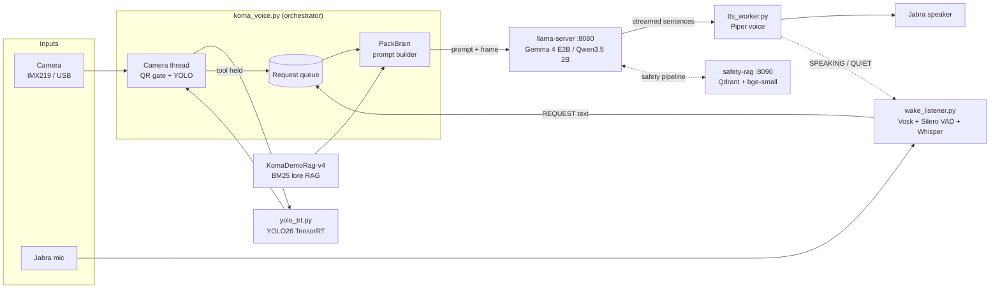

# AI-Toolbox — KOMA

KOMA is a talking, seeing toolbox that runs every model locally on an NVIDIA Jetson Orin Nano. It needs no cloud connection.

## What KOMA does

This device was created to see if we could run vision-language models (VLMs) for workplace safety on hardware-constrained devices. A YOLO object detector gives the small (~2B parameter) VLM extra context about what is in front of the camera. A UK health-and-safety RAG (retrieval-augmented generation) knowledge base grounds the answers, so the model doesn't hallucinate safety recommendations.

In practice, KOMA:

- **Sees.** A YOLO26 model, fine-tuned on tools and PPE and running on TensorRT, watches the camera several times a second. It recognises hammers, wrenches, screwdrivers, pliers, bolts/nuts and faces. When someone holds a tool up to the camera, KOMA reacts.
- **Understands the scene.** When a question refers to what's in view ("what is this?", "what can you see?"), the current camera frame goes to a small VLM along with the question.
- **Gives grounded safety advice.** The safety pipeline first has the VLM write a structured hazard assessment of the frame. Only if a potential hazard is found does it retrieve matching rules from a Great Britain safety knowledge base (HSE guidance, PUWER and similar). A second pass then answers using only those references, so the model can't invent legal requirements, exposure limits or procedures.
- **Talks.** You start a sentence with "Koma" and ask a question. Speech recognition runs offline, and KOMA replies in a custom Piper voice. Saying "Hey Koma" interrupts it mid-sentence.
- **Has a character.** For exhibitions, KOMA plays a toolbox issued to a "TradesMaster" in 2070. A separate lore RAG keeps its story consistent, and it starts a session when a TradesMaster ID card's QR code is shown to the camera.

Camera frames and audio are processed in memory and are not saved. KOMA keeps only the last few exchanges of a conversation and forgets them when a new visitor session starts.

> KOMA is a research prototype. It cannot certify that anything is safe and is not a substitute for a competent person's risk assessment.

## Hardware

| Part | Used for |
|---|---|
| **NVIDIA Jetson Orin Nano 8GB (Super)** | All compute. JetPack / L4T r39, TensorRT 10, run in `MAXN_SUPER` power mode. The 8 GB is shared by CPU and GPU, and RAM is the main constraint. |
| **IMX219 CSI camera** | Original camera, read through `nvarguscamerasrc` (with a lens colour-correction LUT) |
| **16 MP USB UVC camera** | Current camera (`--camera 0`). Switches to 1080p MJPG only while reading the QR ID card, then drops to 640×480 for YOLO and the VLM. |
| **Jabra Speak 510** | USB microphone and speaker |
| Toolbox / bag enclosure | Holds the Jetson for the exhibition build |

**Memory budget.** The full stack runs together in under 8 GB: the VLM server, the YOLO engine, speech-to-text, text-to-speech and the safety RAG. To make it fit:
- the VLM is 4-bit quantised (Q4_K_M GGUF);
- the KV cache is 8-bit with a 4k context;
- YOLO runs on raw TensorRT without PyTorch (about 300 MB instead of about 760 MB);
- the KOMA lore retriever is pure-Python BM25 with no embedding model.

## Software architecture

The system is a set of small processes that talk over HTTP and stdin/stdout pipes. Each part runs in its own Python virtualenv, so their dependencies don't clash, and the whole stack can be restarted piece by piece.



| Component | File(s) | Runs in | What it does |
|---|---|---|---|
| Launcher | `qr_start.py` → `run_model.sh` → `serve_model.sh` | bash | Starts the VLM server, waits for `/health`, then starts KOMA. Shutting KOMA down stops the server too. |
| VLM server | `serve_model.sh` | llama.cpp `llama-server` | Serves one VLM on `127.0.0.1:8080` through an OpenAI-compatible API. Every model gets identical settings, so they can be compared fairly. |
| Orchestrator | `koma_voice.py` | `ultralytics-env` | Owns the camera, the request queue, conversation memory and all the logic for when to speak. |
| Object detection | `yolo_trt.py`, `YOLO26toolmodel/` | `ultralytics-env` | Runs YOLO26 directly on TensorRT and returns `(name, confidence, box)`. |
| Speech-to-text | `wake_listener.py` | `stt-env` | Vosk spots the wake word. Silero VAD finds the end of the sentence, and faster-whisper transcribes it. |
| Text-to-speech | `tts_worker.py`, `voices/` | `tts-env` | Keeps a custom Piper voice loaded and plays sentences on the Jabra. |
| KOMA lore RAG | `KomaDemoRag-v4/` | stdlib Python | Holds about 70 hand-written story chunks, with a BM25 retriever and a validator (`validate_pack.py`). |
| UK safety RAG | `safety-rag/` | `safety-rag-env` | Uses LlamaIndex with a local Qdrant store and FastEmbed `BAAI/bge-small-en-v1.5` over the GB safety knowledge base. Served on `127.0.0.1:8090/retrieve`. |
| Safety camera | `safety-rag/scripts/smolvlm_camera.py` | — | Runs the two-pass hazard triage → RAG → grounded recommendation loop on camera frames. |
| Benchmarking | `bench_models.py`, `compare_models.py`, `tests/` | `ultralytics-env` | Runs the same questions and images through each VLM and produces side-by-side answers for blind rating. |

### Models

| Role | Model |
|---|---|
| VLM (default) | **Gemma 4 E2B-it** (Q4_K_M plus Q8 mmproj), which scored best in the benchmarks |
| VLM (alternatives) | Qwen3.5-2B, Ministral 3 3B, and Nemotron 3.5 Bolt E4B (text only, `--no-vision`) |
| VLM (safety pipeline) | SmolVLM2-2.2B-Instruct |
| Detector | YOLO26s fine-tuned on tools and PPE (`toolppefinetune.engine`) |
| Embeddings | BAAI/bge-small-en-v1.5 (FastEmbed, ONNX) |
| STT | Vosk small-en-us (wake word) plus faster-whisper (transcription) |
| TTS | Piper with a custom KOMA voice (based on lessac-high) |

## How the model, RAG, voice and camera interact

### 1. Start-up and the QR gate

```
./qr_start.py gemma --camera 0 --no-color-fix --rotate 180 --conf 0.3
```

`qr_start.py` replaces itself with `run_model.sh`. That script starts `llama-server` in the background, and `koma_voice.py` then loads the TensorRT detector, Piper and the wake listener. Next, KOMA sends the VLM its system prompt once (`warm_up()`), so llama.cpp caches it and later answers start faster.

Nothing is spoken and no speech is accepted until the camera thread decodes the right QR code (`JETSON-START-001` by default). Once it does, KOMA reads `welcome.txt` word for word and starts listening. Because everything is loaded before the card is shown, there's no wait in front of a visitor.

### 2. Camera → YOLO → speech

The camera thread in `koma_voice.py` reads frames continuously, so the newest frame is always ready. About 5 times a second it runs YOLO:

1. Faces and people are treated as **anchors**. Each anchor's box is widened (most widely below a face, where a held tool would be).
2. A tool whose box overlaps a widened anchor counts as **held**. If it stays held for `--confirm-seconds`, it triggers.
3. A triggered tool's line in `tool_prompts/<tool>.txt` is sent straight to Piper, word for word, without going through the VLM. Scripted lines are instant and can't be hallucinated. Each tool triggers once per run.
4. **YOLO pauses while KOMA is speaking or answering**, so it never interrupts itself and doesn't compete with the VLM for the GPU.

The tool line is also added to the conversation history, so if the visitor asks "what did you mean by that?", the VLM knows what KOMA just said.

### 3. Voice → VLM → voice

```
Jabra mic ─► wake_listener.py ─stdout─► koma_voice.py ─HTTP─► llama-server ─stream─► tts_worker.py ─► Jabra speaker
                    ▲                                                                       │
                    └──────────────────── stdin: SPEAKING / QUIET ◄─────────────────────────┘
```

1. **Wake.** Vosk listens for "Koma". To prevent false wakes, Whisper must also hear the name in the audio just before the request (the pre-roll). While KOMA is talking, only a confident "Hey Koma" counts, so KOMA's own voice saying its name doesn't wake it. A wake also cancels any speech in progress.
2. **Transcribe.** Recording continues until Silero VAD hears silence. faster-whisper then transcribes the request, and the result is sent as `REQUEST <text>`.
3. **Classify.** `brain.classify()` sorts the request into a `question`, `safety`, `handover` or `new_visitor` event. Each type has its own sentence and token limit.
4. **Build the prompt.** `PackBrain` retrieves the top lore chunks for the question and adds the last few exchanges. If the question is about the scene, it attaches the current camera frame, resized to 640 px and JPEG-encoded. A "what do you see?" question skips lore entirely, so the story can't steer a description of the real world.
5. **Stream and speak.** `stream_vlm()` reads the server's streamed reply and splits it into sentences. Each sentence goes to Piper as soon as it is complete, so KOMA starts speaking before the VLM has finished. The stream is closed once the sentence limit is reached, which stops generation on the server.
6. **Echo control.** The TTS worker tells the listener when KOMA starts and stops speaking. This is how the stricter "Hey Koma" rule is switched on and off.

### 4. Camera → VLM → UK safety RAG (the safety pipeline)

`smolvlm_camera.py` makes two passes over the VLM. Retrieval happens between them, and only when the first pass finds a hazard:

```
frame ─► Pass 1: VLM triage (JSON) ─► hazard? ──no──► "No observable hazard" (RAG not queried)
                                         │yes
                                         ▼
                           POST observation ─► safety-rag :8090 ─► top-3 GB safety references
                                         │
                                         ▼
          Pass 2: VLM answers using ONLY the observation + references ─► ≤3-sentence recommendation
```

- **Pass 1** forces a structured assessment: `WORK_ACTIVITY`, `TOOLS_EQUIPMENT`, `MATERIALS`, `PEOPLE`, `POTENTIAL_HAZARDS` and `RAG_REQUIRED`. If the output is malformed, the pipeline queries the RAG anyway rather than skipping safety rules.
- **Retrieval** embeds the observation with bge-small and returns the three closest passages from `documents/test_safety_rules.md`, with source and score.
- **Pass 2** has the VLM act as a health-and-safety advisor. It may use only the retrieved references and must not invent requirements or citations.
- The knowledge base itself separates what is *observed* from *potential* hazards, from things needing *measurement*, from *legal requirements* and from *HSE guidance*. It also tells the model not to imply danger where no work activity is visible.

To add rules, put `.md`, `.txt` or `.pdf` files in `safety-rag/documents/` and run `scripts/ingest.py` to rebuild the index.

## Running it

```bash
# 1. UK safety RAG (only needed for the safety pipeline)
cd safety-rag
~/safety-rag-env/bin/python scripts/ingest.py         # build the Qdrant index once
~/safety-rag-env/bin/python scripts/rag_server.py     # serves :8090

# 2. KOMA with the QR gate and a browser view of the camera
./qr_start.py gemma --camera 0 --no-color-fix --stream 8091

# Without a mic or speaker: type questions and read the answers
./run_model.sh gemma --type --mute

# Detector only, with a live annotated view in the browser
~/ultralytics-env/bin/python yolo_view.py
```

Run `./koma_voice.py --help` to see every option (camera rotation, detection confidence, voice speed and pitch, memory turns, and so on).

**Not included in this repo** (too large for git; see `.gitignore`):
- Model weights: `*.gguf`, `*.pt`, `*.onnx` and `*.engine`. Rebuild the TensorRT engines on the Jetson with `export_engine.sh`.
- The custom Piper voice in `voices/`.
- The Python virtualenvs. `safety-rag/requirements.txt` lists the safety RAG's packages.
- Runtime output: `captures/`, `logs/`, `events/` and `bench/`.

## Repository layout

```
koma_voice.py          main orchestrator (camera, YOLO, voice, VLM, memory)
koma.py                shared helpers: Piper Speaker, stream_vlm, frame encoding (+ original pipeline)
brain.py               event classifier and the original HELIOS lore retriever
yolo_trt.py            TensorRT YOLO26 inference without PyTorch
wake_listener.py       Vosk wake word + Silero VAD + faster-whisper
tts_worker.py          persistent Piper TTS process
qr_start.py            QR-gated launcher
run_model.sh           start a VLM server, then KOMA
serve_model.sh         llama-server settings for every supported VLM
tool_prompts/          scripted line per detected tool
welcome.txt            what KOMA says when the ID card is accepted
KomaDemoRag-v4/        KOMA lore pack: chunks, retriever, system prompt, validator
safety-rag/            UK workplace safety RAG + the two-pass safety camera
bench_models.py        VLM benchmark harness (compare_models.py for review)
tests/                 benchmark questions and images
```
